# Field Shift — Adapting Farms with NASA Data

**Turn 45 years of NASA Earth observations into ranked, explainable crop-rotation plans for a farm or a district — in Bangla or English, on a mobile-first screen.**

[](https://github.com/Zul-Qarnain/field-shift/actions/workflows/ci.yml)
[](LICENSE)
[](https://nextjs.org/)
[](https://www.python.org/)
[](https://www.spaceappschallenge.org/2026/challenges/field-shift-adapting-farms-with-nasa-data/)

**Live demo → https://field-shift-tan.vercel.app** · Challenge: *Field Shift: Adapting Farms with NASA Data* · NASA Space Apps Challenge 2026, Bangladesh local event.

Field Shift is a decision-support web app for Bangladesh's three-season farming calendar. Every displayed figure names the dataset it came from, its version and the day it was retrieved; every recommendation opens a **"See why"** panel with the arithmetic behind it. There is no backend, no API key and no runtime language model — the science runs in Python before the build, ships as committed JSON data packs, and is scored deterministically in the browser.

### Contents

| | | |
|---|---|---|
| [The problem](#the-problem) | [Data sources](#data-sources) | [Testing](#testing) |
| [How we answer the challenge](#how-we-answer-the-challenge) | [Tech stack](#tech-stack) | [Roadmap](#roadmap) |
| [Features](#features) | [Project structure](#project-structure) | [Team](#team) |
| [How it works](#how-it-works) | [Quickstart](#quickstart) | [Documentation](#documentation) |
| [The scoring and rotation engine](#the-scoring-and-rotation-engine) | | [Acknowledgments, license and disclaimer](#acknowledgments-license-and-disclaimer) |
| [Machine-learning monsoon forecast](#machine-learning-monsoon-forecast) | | |

---

## The problem

**Karim, a farmer in Satkhira, has to decide in April what to plant for the next three seasons — while the rains, the heat and the salt in his soil keep shifting.**

By 2050, one-third of Bangladesh's agricultural GDP may be lost due to climate variability and extreme events — [World Bank, *Country Climate and Development Report for Bangladesh* (2022)](https://www.worldbank.org/en/news/feature/2022/10/31/key-highlights-country-climate-and-development-report-for-bangladesh).

Karim's real questions are not "what is the rainfall anomaly". They are: *has my usable-rainfall onset moved, and by how many days? Is my soil too salty for maize this winter? Which rotation feeds the soil instead of mining it? What happens to the plan if the season runs 2 °C hotter?* A chart answers none of those. Field Shift ends on a sentence, not a chart.

---

## How we answer the challenge

| Challenge requirement | Field Shift feature | Where (page / file) |
|---|---|---|
| **NASA Earth observations** | 45 years of NASA POWER daily point data (7 parameters) for 70 locations, reduced to committed JSON packs; plus a live NASA POWER call in the browser for "This season so far" | `/field`, `/quick` · `src/acquire/power.py`, `scripts/build_packs.py`, `web/public/data/packs/` |
| **Local soil information** | Upazila soil-salinity classes from the national survey (SRDI 2010), joined to each farm by point-in-polygon and rolled up per district; expected yield loss per crop from FAO-29's own line | `/field`, `/quick` · `src/acquire/salinity.py`, `web/public/data/salinity.json` |
| **Crop characteristics** | A 12-entry Bangladesh crop pool — Aman/Aus/Boro rice, wheat, maize, potato, mustard, lentil, mungbean, sesame, jute, fallow — with duration, water demand, heat and flood tolerance, pH range, nitrogen demand/fixation, residue return, botanical family, and FAO-29 salt thresholds per crop | `web/lib/data.ts` |
| **Farmer priorities** | Four sliders — *Water saving · Soil health · Stable harvest · Heat & flood safety* — that re-weight the score instantly on device; the quick answer offers the same as one-tap presets | `/plan`, `/quick` · `web/lib/engine.ts`, `web/lib/quick.ts` |
| **Explore rotation strategies** | The engine enumerates every legal Aman → Rabi → pre-monsoon sequence from the chosen crop pool, ranks them, and re-ranks live under what-if scenarios (drier −10 %/−20 %, hotter +1 °C/+2 °C, later onset +7/+15 days) | `/plan` · `web/lib/engine.ts` |
| **Soil health** | A dedicated *Soil health balance* component (residue return, nitrogen balance, legume credit) plus *Diversity & break* (family mix, root-layer alternation), and same-family carryover penalties the farmer can read | `/plan`, "See why" · `web/lib/engine.ts` |
| **Water conservation** | *Water adequacy* and *Low irrigation reliance* components, the drier-season scenarios, and a pumping-dependence line in the advisory | `/plan` · `web/lib/engine.ts` |
| **Resilience to changing conditions** | A *Resilience* component over Aman flood exposure, dry-season heat and rain deficit; measured onset shift, days above 35 °C, mean temperature and root-zone wetness per location; a statistical gate so only a significant shift reaches a plan | `/field`, `/plan` · `src/compute/onset.py`, `web/lib/engine.ts` |
| **Accessible to farmers** | Full Bangla UI including Bengali digits, `/quick` one-screen answer, `/locate` map-click or district picker, an advisory sentence plus SMS-length text with a live 160-character counter, mobile-first layout | `/quick`, `/locate` · `web/lib/i18n.ts`, `web/lib/engine.ts` |

---

## Features

### Start here — two ways in

The home page offers the quick answer and the location picker next to the six demo farms, and the whole interface switches between English and Bangla (the choice is remembered on the device).

<table>
  <tr>
    <td width="50%">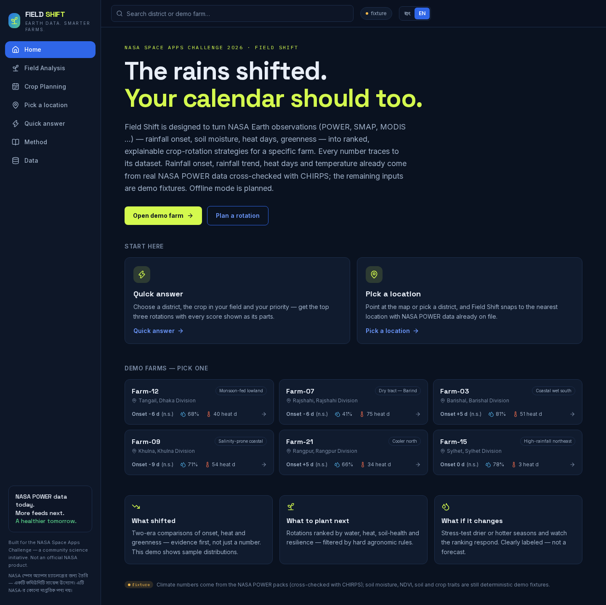</td>
    <td width="50%">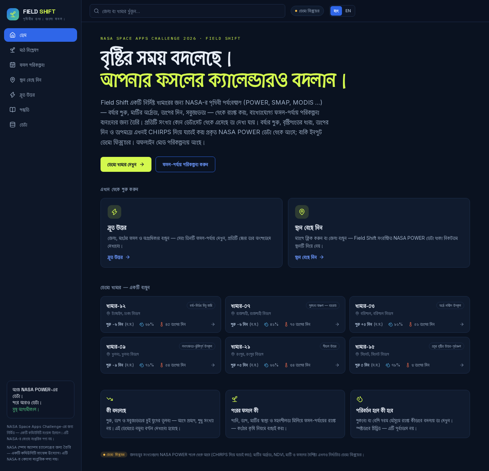</td>
  </tr>
  <tr>
    <td><b>English</b> — 6 demo farms across six divisions, plus every district.</td>
    <td><b>বাংলা</b> — the same page, same numbers, Bengali digits throughout.</td>
  </tr>
</table>

### Quick answer — `/quick`

Three choices on one screen: a district (any of the 64), the crop standing in the field now, and what matters most. The answer is the top three rotations that keep that crop in its season, each drawn as a **stacked score bar** — the eight component contributions, the penalties as a subtraction, the early-onset credit — with the equation printed underneath so the parts visibly add up to the total. *See why* opens the full analysis: every component's value × weight, every penalty with its rule and source, the reasons, the risks and the inputs used — that district's own NASA POWER pack and onset verdict, SRDI's district-level salinity rollup, and the nearest demo farm's soil, water and irrigation inputs, named with its distance (district-level soil layers are in progress for the next phase).

<table>
  <tr>
    <td width="50%">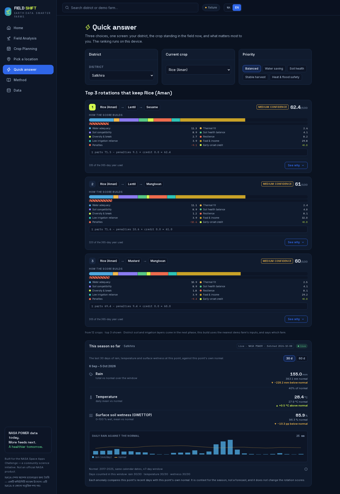</td>
    <td width="50%">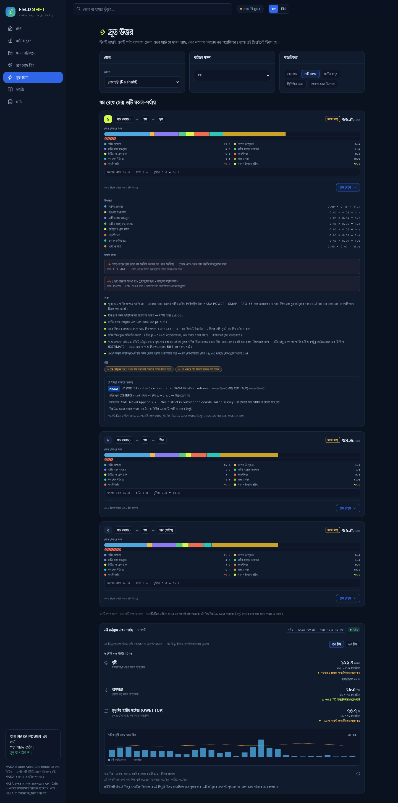</td>
  </tr>
  <tr>
    <td><b>One screen, three rotations.</b> The ranking is computed on the device from the committed data pack.</td>
    <td><b>See why, in Bangla.</b> Every component, penalty and source line is generated in both languages with the same numbers.</td>
  </tr>
</table>

### Pick a location — `/locate`

Click the map or choose a district. The pick snaps to the nearest of the **70 precomputed points** (the 6 demo farms + the 64 district data points) and the page states which point it used, whether it is a district pack or a demo farm, and the distance in km. District boundaries and centroids are geoBoundaries gbOpen BGD ADM2; the map renders OpenFreeMap vector tiles with a NASA GIBS true-colour overlay.

<table>
  <tr>
    <td width="50%">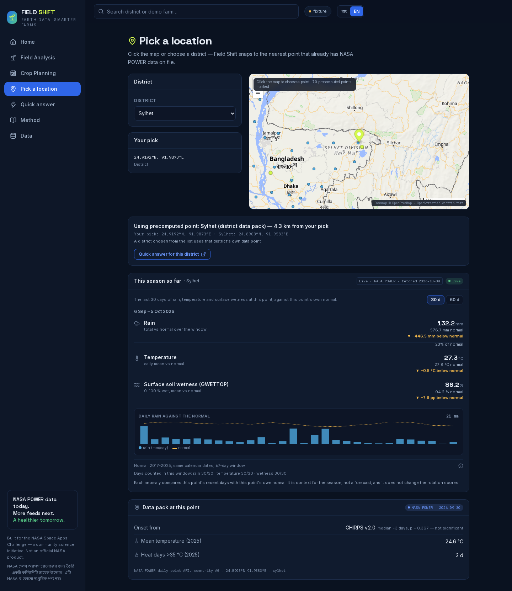</td>
    <td width="50%">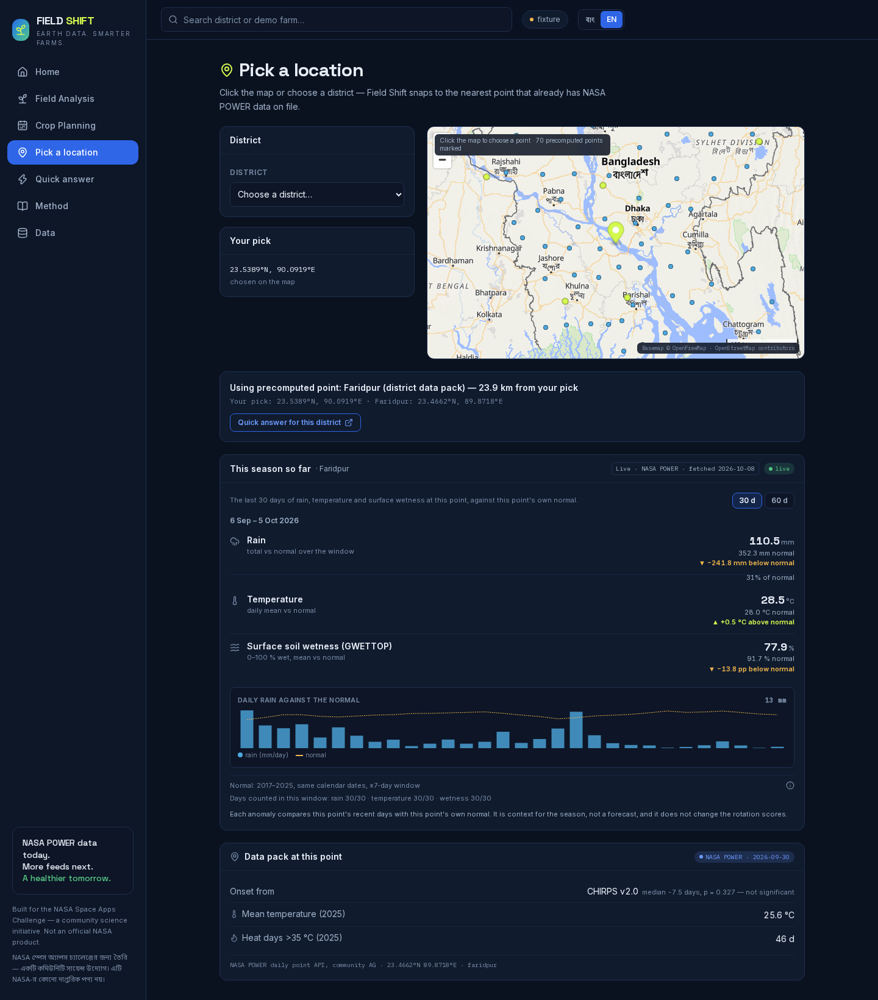</td>
  </tr>
  <tr>
    <td><b>Choose a district.</b> That district's own NASA POWER data point answers, and the centroid distance is stated.</td>
    <td><b>Click the map.</b> The nearest precomputed point is named, with its distance; picks outside Bangladesh are refused.</td>
  </tr>
</table>

### Field analysis — `/field`

One card per farm, built from the committed pack: **monsoon onset under definition v2** (a local-relative 5-day accumulation rule adapted from the Moron & Robertson 2014 family, searched DOY 121–270), the two eras 2001–2012 vs 2013–2025 compared with a two-sided **Mann-Whitney U**, ±20 % threshold sensitivity, heat days above 35 °C from `T2M_MAX`, mean temperature and modelled root-zone wetness (`GWETROOT`), and the **same rainfall statistics re-computed independently from CHIRPS v2.0** with a **Pettitt change-point test** on both series — each figure naming the product it came from, and a stated preference rule deciding which one the app reads.

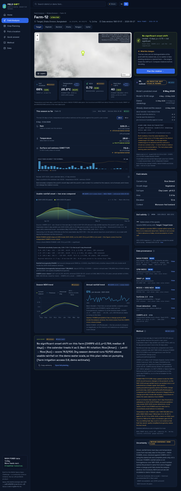

### Soil salinity — the local soil layer

SRDI (2010) *Saline Soils of Bangladesh*, Appendix-2: 102 upazilas across 18 coastal districts. Class areas become a representative ECe (area-weighted class midpoint), then an expected yield loss per crop through FAO-29 Rev.1's own line **Y = 100 − b·(ECe − a)** — which is what the engine charges as a listed, sourced penalty. Worked from the committed data: at **Khulna / Dumuria**, where 68.3 % of the upazila is saline (30 610 of 44 797 ha), a rice season loses ~42 % expected yield → −6.7 engine points and maize or potato ~49 % → −7.8; at **Barishal / Wazirpur** (8.1 % saline) rice loses ~0.6 % → −0.1. Upazilas outside the surveyed coastal belt carry no value at all and the panel says so — absent data is not zero salt. Crops FAO-29 publishes no ECe for (mustard, lentil, mungbean, sesame, jute) are listed as risks rather than scored against salinity.

### Crop planning engine — `/plan`

Ranked rotations with priorities, crop-pool control and what-if scenarios; each plan shows its calendar budget (days used, days spare) and the component bar. Output ends with an advisory sentence and an SMS-length text in both languages, ready to copy.

### Machine-learning monsoon forecast

A **LightGBM** model trained offline on real satellite rainfall and NASA POWER weather, issued each year on **25 April**, forecasting that year's monsoon onset date with a 10–90 range and the drivers that moved it — shown on every farm page. Full section below.

### "This season so far" — live nowcast with a saved-data fallback

The last **30 or 60 days** of NASA POWER `PRECTOTCORR`, `T2M` and `GWETTOP` at the chosen point, as totals/means and as anomalies against that point's own 2017–2025 normal for the same calendar dates. The card sits on the farm page, the quick answer and the location picker. The browser fetches the recent days live from the public POWER daily API (no key, 8-second timeout); the normal comes from the committed pack. It is season context and never touches a score.

<table>
  <tr>
    <td width="50%">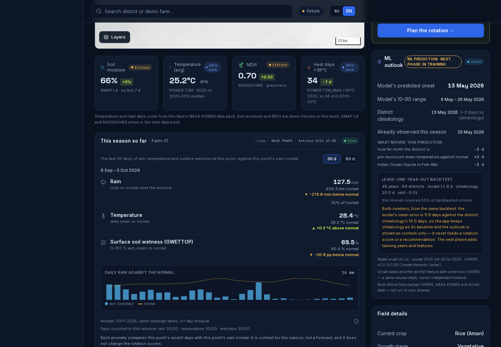</td>
    <td width="50%">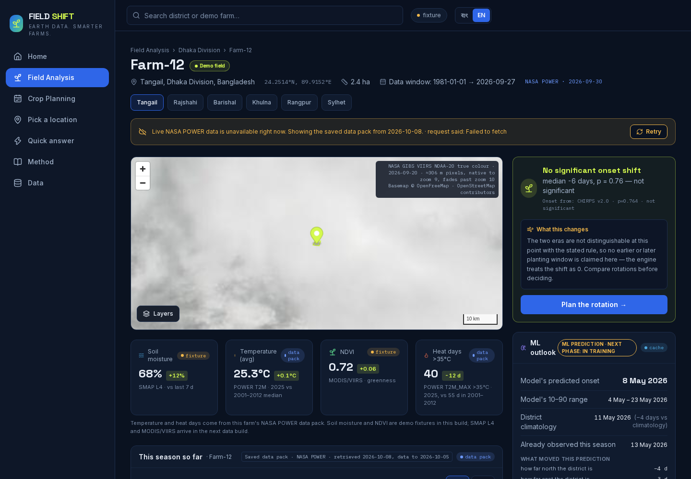</td>
  </tr>
  <tr>
    <td><b>Live.</b> Rain, temperature and surface soil wetness against the point's own normal, with the fetch date stated.</td>
    <td><b>Fallback.</b> If the live call is unavailable, a banner says so, the saved pack's numbers are shown with their retrieval date, and <i>Retry</i> runs the call again.</td>
  </tr>
</table>

### Method & Data — `/method`, `/data`

Every definition, threshold and formula in plain language, plus the dataset register read from the committed artifacts themselves: product, provider, resolution, retrieval timestamp, URL and licence. Each source carries a tier badge — **NASA** · **Partner** · **Open** (open non-space) · **You** (user-entered) — so a reader can tell a NASA observation from a national soil survey at a glance.

### Bangla and English throughout

District, division, farm, crop, soil texture, farm context, score labels, headings, chart legends, tooltips, button text and every number — in Bengali digits — switch language, including inside the data-pack and salinity panels. The advisory, the SMS and the engine's reason, risk and penalty sentences are generated in both languages with the same numbers in each. Dataset names, version ids, file paths and the packs' own method text stay in English, and the UI says so. The choice is remembered on the device.

### Advisory and SMS text

`web/lib/engine.ts` templates a plain-language advisory (onset verdict, best-fit rotation, score, pumping dependence) and a matching SMS-length message in Bangla and English, with a live `{characters}/160` counter on the plan page. The app **generates** the text and copies it to the clipboard; sending is done by the user's own messaging app.

---

## How it works

Static-first: Python acquires and computes before the build, the results are committed as JSON, and Next.js scores them in the browser. The one runtime data call in the app is the nowcast's NASA POWER request, which falls back to a committed pack.

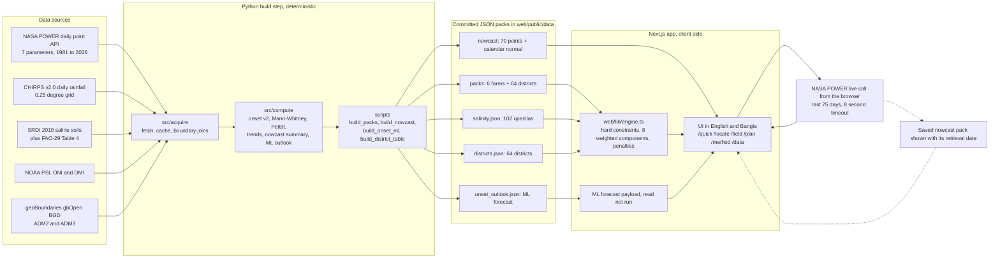

The request flow for one user session:

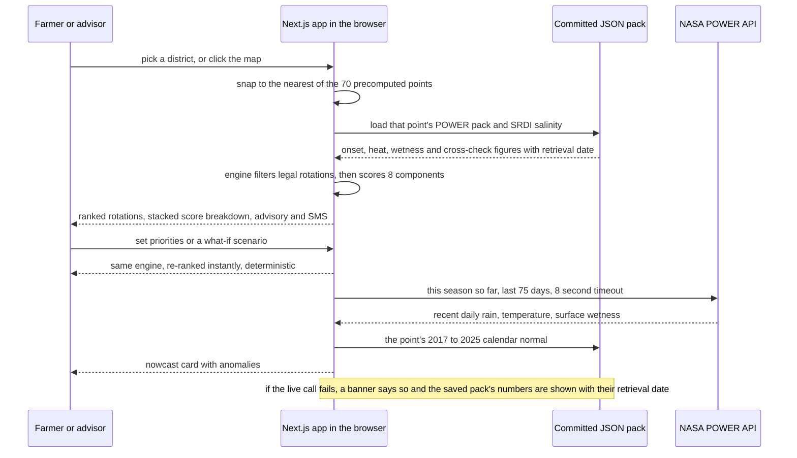

---

## The scoring and rotation engine

Plainly: **first discard what is impossible, then rank what remains by what the farmer said matters most.** Every step is a small pure function in `web/lib/engine.ts`.

**Hard constraints (filter).** A candidate is a three-season sequence, Aman → Rabi → pre-monsoon. One crop per season, no crop filling two slots, and the whole sequence must fit a **365-day calendar** — crop durations, **10-day turnarounds** between crops, plus this season's effective onset shift. A sequence that does not fit never reaches scoring.

**Eight weighted components** (names and labels as they appear in the code and UI):

| | Component | What it measures |
|---|---|---|
| S1 | Water adequacy | Supply against each crop's water demand, per season, as a smooth margin |
| S2 | Thermal fit | Crop heat tolerance against the season's heat exposure (`T2M_MAX`/`T2M`) |
| S3 | Soil compatibility | Each crop's pH range against the site's soil pH, scored as a smooth distance from the tolerance band |
| S4 | Soil health balance | Residue return, nitrogen balance, legume credit, minus sequence carryover |
| S5 | Diversity & break | Botanical-family mix and root-layer alternation across the sequence |
| S6 | Resilience | Aman flood exposure, dry-season heat, rain deficit and late-onset pressure |
| S7 | Low irrigation reliance | How much dry-season demand usable rainfall cannot cover |
| S8 | Food & income | Each season's income value graded by its water margin, plus the staple actually delivered |

**Farmer priorities move the weights.** Each slider drives its own components — *Water saving* lifts S1 and S7, *Soil health* lifts S4, *Stable harvest* lifts S2, S8 and part of S6, *Heat & flood safety* lifts S6 — and the weight block is normalised to sum to 1, so raising one axis is a real trade, not a scaling trick.

**Penalties are listed, not hidden.** Continuous, floor-then-slope rules so a threshold flip cannot silently reorder plans:

| Penalty | Rule |
|---|---|
| Soil salinity | FAO-29 Rev.1 line **Y = 100 − b·(ECe − a)** over the SRDI class distribution, charged at 16 points per 100 % expected yield loss, per crop-season |
| Aman flood exposure | (flood-proneness × (1 − crop flood tolerance) − 0.02 floor) × 16 points |
| Dry-season heat | (season heat × (1 − crop heat tolerance) − 0.25 floor) × 16 points |
| Late monsoon onset | (onset heat risk − 0.03 floor) × 36 points |
| Same-family succession | cereal after cereal 2.0, legume after legume 1.0, other family 1.5 points, plus a soil-health hit |
| Idle fallow | 4 points scaled by how much of a crop window was genuinely left free |
| Early-onset credit | up to 3 points for long-duration crops when the onset moves earlier |

**The total is arithmetic, not a black box:**

```
total = 100 × Σ(component value × component weight) − Σ(penalties) + early-onset credit
```

**The onset significance gate.** A measured two-era onset difference enters the engine — the calendar budget, the late/early-onset terms, the headline card, the advisory and the SMS — **only when that location's two-sided Mann-Whitney U test rejects at p < 0.05**. Otherwise the shift is carried as 0 days and the interface says so. A marginal statistic cannot buy or cost a farm growing days.

**What-if scenarios** re-run the same engine on the same data: rainfall −10 % / −20 %, temperature +1 °C / +2 °C, and onset +7 / +15 days. The plan page shows the re-ranking and labels the scenario as the stated hypothetical it is.

**Deterministic and explainable.** Same inputs, same output, every time — which is what makes the stacked bar honest: the quick answer's parts add up to the shown total to the last decimal (largest-remainder rounding). *See why* lists every component's value × weight, every penalty with its rule and source, and the reasons and risks. 688 Vitest tests pin the constraints, the weights, the penalties and the bilingual output.

---

## Machine-learning monsoon forecast

**Built, and shown on every farm page** under the heading *"Machine-learning monsoon forecast"*, with the line *"Trained on satellite rainfall (CHIRPS) and NASA POWER, with NOAA ocean indices."*

| | |
|---|---|
| Model | **LightGBM** gradient boosting (`onset-ml-v2`), one conditional-mean head plus two quantile heads (α = 0.1 / 0.9) for the range |
| Labels | Monsoon onset dates derived from **CHIRPS v2.0** daily rainfall under the same deterministic onset rule v2 the packs use |
| Weather features | **NASA POWER** daily point series — pre-monsoon rainfall anomaly, `T2M`, `T2M_MAX` and `RH2M` anomalies, end-of-window root-zone wetness, and the previous season's onset |
| Ocean indices | **NOAA PSL** ONI (ERSSTv6 Niño 3.4, Dec–Feb and Feb–Apr centres) and DMI (HadISST1.1, Feb–Mar) |
| Geography | All **64 districts** as training points, with coordinates as features; the 6 demo farms read their own forecast row |
| Training span | 45 seasons, 1981–2025, validated by a leave-one-year-out backtest in which a whole season's districts are held out together |
| Issue date | **25 April** — no feature may use information that did not exist by then, and the leakage controls are asserted in tests |
| What the card shows | The forecast onset date for **2026**, the model's **10–90 range**, and *"What moved this prediction"* — the top drivers in days, from exact tree SHAP contributions (`pred_contrib=True`) |
| Where it runs | Built offline by `scripts/build_onset_ml.py` into `web/public/data/onset_outlook.json`. The browser reads JSON; it never runs the model |

Pipeline: `src/acquire/chirps.py` + `power.py` + `indices.py` → `src/compute/ml/features.py` (fold-local climatology, leakage-guarded) → `src/compute/ml/onset_ml.py` → `src/compute/ml/outlook.py` → JSON payload → `web/components/OnsetOutlookCard.tsx`. Method, feature table and leakage controls: [`docs/science/onset_ml.md`](docs/science/onset_ml.md).

The forecast is season context alongside the measured onset statistics. The rotation ranking keeps running on the deterministic onset rule, so a plan never depends on a single model output.

---

## Data sources

Retrieval dates, versions and licences are read from the committed artifacts (`web/public/data/*` provenance fields) and from `docs/`.

| Dataset | Provider | What we use it for | Version / resolution | Retrieved | Licence |
|---|---|---|---|---|---|
| **NASA POWER daily point series** | NASA Langley Research Center (POWER) | Climate backbone: onset detection, heat days, temperature, rainfall statistics, modelled root-zone wetness | Daily API **v2.10.0**, community AG, 7 parameters (`PRECTOTCORR, T2M, T2M_MAX, T2M_MIN, GWETROOT, RH2M, ALLSKY_SFC_SW_DWN`), point (0.5°/1° grid), 1981-01-01 → 2026-09-27 | 2026-09-30, 08:53:57–09:08:07 UTC (70 points) | NASA open data |
| **NASA POWER — nowcast series** | NASA Langley (POWER) | "This season so far": last 30/60 days and the 2017–2025 calendar normal; the same API is also called **live in the browser** | Daily API **v2.10.0**, `PRECTOTCORR, T2M, GWETTOP`, 2017-01-01 → 2026-10-07 (data to 2026-10-05) | 2026-10-08, 19:27:56–19:29:57 UTC (70 points) | NASA open data |
| **CHIRPS v2.0 daily rainfall** | Climate Hazards Center, UCSB / USGS | Independent cross-check of every rainfall statistic, the ML onset labels and the pre-monsoon rainfall feature | CHIRPS **v2.0**, daily, 0.25° (~25 km) nearest cell, 1981–2025 (+ 2026 outlook file) | 2026-09-30 | Open data from UCSB CHC / USGS — see provider terms · citation: Funk et al. 2015, *Scientific Data* 2:150066 |
| **SRDI — *Saline Soils of Bangladesh* (2010), Appendix-2** | Soil Resource Development Institute, Ministry of Agriculture, Government of Bangladesh | Upazila soil-salinity class areas S1–S5 → representative ECe → expected yield loss | 102 upazilas in 18 coastal districts; May-2009 dry-season survey, 2 500 samples, EC on a 1:5 soil-water extract; published 2010 | 2026-09-30 | Government of Bangladesh, Ministry of Agriculture — public document |
| **FAO Irrigation & Drainage Paper 29 Rev.1, Table 4** | FAO (Ayers & Westcot, 1985) | Crop salt tolerance thresholds and slopes: the line Y = 100 − b·(ECe − a) behind the salinity penalty | Rev. 1, Table 4 + equation 10, per crop (dS/m) | read 2026-09-30 | FAO open |
| **geoBoundaries gbOpen BGD ADM2** | wmGeolab / geoBoundaries (BBS / OCHA ROAP) | The 64 district polygons: centroids, representative data points, the location picker register | ADM2, release revision `9469f09`; Runfola et al. 2020, *PLoS ONE* 15(4): e0231866 | 2026-09-30 | CC BY 3.0 IGO |
| **geoBoundaries gbOpen BGD ADM3** | wmGeolab / geoBoundaries (BBS / OCHA ROAP) | Upazila point-in-polygon: which SRDI unit each farm falls in | ADM3, release revision `9469f09` | 2026-09-30 | CC BY 3.0 IGO |
| **NOAA PSL ONI** | NOAA Physical Sciences Laboratory | ENSO state as ML features only (Dec–Feb and Feb–Apr centres) | 3-month running mean of ERSSTv6 Niño 3.4 | 2026-09-30, 08:57:03 UTC | NOAA public data |
| **NOAA PSL DMI** | NOAA Physical Sciences Laboratory | Indian Ocean Dipole state as an ML feature (Feb–Mar) | Dipole z-score, HadISST1.1 | 2026-09-30, 08:57:03 UTC | NOAA public data |
| **NASA GIBS — VIIRS NOAA-20 True Color** | NASA EOSDIS GIBS | Satellite imagery overlay on the map | WMTS `GoogleMapsCompatible_Level9`, ~306 m pixels, scene date 2026-09-20 | live tile requests | NASA open data |
| **OpenFreeMap + OpenStreetMap** | OpenFreeMap / OSM contributors | Basemap vector tiles for `/locate` and the farm map | `liberty` style, vector tiles | live tile requests | ODbL / free (OpenStreetMap contributors) |

Every figure the app shows traces to one of these rows, and the in-app **Data** page prints the same provenance from the committed JSON.

---

## Tech stack

**Web** (`web/package.json`)

| | |
|---|---|
| Framework | Next.js **16.3.6** (App Router) · React **19.2.8** · TypeScript **^5** |
| Styling | Tailwind CSS **v4** (`@tailwindcss/postcss`) |
| Maps | MapLibre GL **6.11.2** (OpenFreeMap tiles + NASA GIBS overlay) |
| Charts | Recharts **3.10.1** · Icons: lucide-react **^1.48.0** |
| Testing | Vitest **^5.0.2** · Playwright **^1.64.0** · ESLint **9** (`eslint-config-next` 16.3.6) |
| Node | **22** — the version CI runs |

**Python pipeline** (`requirements.txt`, Python **3.13**)

| | |
|---|---|
| Acquisition | requests ≥2.32 · shapely ≥2.0 (point-in-polygon) |
| Science | pandas ≥2.2 · numpy ≥2.0 · scipy ≥1.13 (Mann-Whitney, Mann-Kendall, Theil-Sen, Pettitt) |
| Gridded data | xarray ≥2024.1 · netCDF4 ≥1.6 (CHIRPS reader) |
| Machine learning | LightGBM ≥4.7 |
| Testing | pytest ≥8.0 |

No runtime backend, server database, LLM call or paid service anywhere in the demo path.

---

## Project structure

```text
field-shift/
├── src/
│   ├── acquire/         # power.py (NASA POWER point API), chirps.py (netCDF reader),
│   │                    # districts.py (geoBoundaries), indices.py (NOAA PSL ONI/DMI),
│   │                    # salinity.py (SRDI CSV + ADM3 join), bd_districts.csv
│   ├── compute/         # onset.py (rule v1/v2), trends.py, nowcast.py, ml/ (features, model, outlook)
│   └── data/salinity/   # srdi_2010_upazila.csv (committed transcription) + README.md provenance
├── scripts/             # build_packs.py, build_nowcast.py, build_onset_ml.py,
│                        # build_district_table.py, fetch_chirps_2026.py
├── tests/               # pytest suite (260 tests) + tests/fixtures (ONI/DMI sample series)
├── web/
│   ├── app/             # / , /field , /plan , /quick , /locate , /method , /data
│   ├── components/      # NowcastCard, LiveDataBanner, QuickAnswerCard, OnsetOutlookCard,
│   │                    # LocateMap, MapLive, RotationCard, RealPack, PackNotes, Shell, charts, ui
│   ├── lib/             # engine.ts, data.ts, quick.ts, locate.ts, packs.ts, nowcast.ts,
│   │                    # outlook.ts, i18n.ts, lang.tsx, clipboard.ts
│   ├── public/data/     # packs/ (index + 6 farms + 64 districts), nowcast/ (70 + index),
│   │                    # districts.json, salinity.json, onset_outlook.json
│   ├── tests/           # Vitest suite (11 files, 688 tests)
│   └── e2e/             # Playwright suite (3 files, 12 tests) + playwright.config.ts
├── docs/                # architecture (v1.5, ADR-001–012), UI/UX design system,
│   ├── science/         # onset.md, onset_ml.md
│   ├── screenshots/     # readme/ shots used above, plus per-page captures
│   ├── lighthouse/      # performance reports
│   └── AI_USE.md, prompts_used.md
├── .github/workflows/ci.yml
├── requirements.txt
└── LICENSE              # Apache-2.0
```

---

## Quickstart

**Prerequisites:** Node **22** (the version CI uses) and Python **3.13** (the version the pipeline is developed and tested on) with `venv`.

### Web app

```bash
cd web
npm ci                      # install from the lockfile
npm run dev                 # http://localhost:3000
```

```bash
npm test                    # 688 Vitest tests (engine, packs, nowcast maths, quick answer, i18n)
npm run lint                # ESLint
npx tsc --noEmit            # type check
npm run build               # production build (type-checked)
npx playwright install chromium   # first time only
npm run test:e2e            # 12 Playwright tests against the built app on port 3210
npm run test:all            # lint + type check + unit + build + e2e
```

### Python pipeline

```bash
python -m venv .venv
.venv/bin/pip install -r requirements.txt
.venv/bin/python -m pytest -q          # 260 tests, no network required
```

### Rebuild the data artifacts

Each script caches its raw responses under `cache/` (gitignored) and records the UTC retrieval time in the committed output, so a rerun keeps provenance honest. The committed packs are the shipped artifact — never fetch from a page view.

```bash
.venv/bin/python -m src.acquire.districts        # geoBoundaries ADM2 → src/acquire/bd_districts.csv
.venv/bin/python scripts/build_packs.py          # NASA POWER + CHIRPS → web/public/data/packs/ (70 packs + index)
.venv/bin/python scripts/build_nowcast.py        # POWER nowcast series → web/public/data/nowcast/ (70 packs + index)
.venv/bin/python scripts/build_onset_ml.py       # backtest + outlook → web/public/data/onset_outlook.json
.venv/bin/python scripts/fetch_chirps_2026.py    # one real CHIRPS download for the outlook year
.venv/bin/python src/acquire/salinity.py         # SRDI CSV + geoBoundaries ADM3 → web/public/data/salinity.json
.venv/bin/python scripts/build_district_table.py # district register → web/public/data/districts.json
```

`build_packs.py` also takes `--only-farms`; `build_nowcast.py` takes `--limit N` and `--end YYYYMMDD`; `build_onset_ml.py` takes `--limit`, `--years` and `--rounds`. The CHIRPS cross-check reads local netCDF boxes from `${CHIRPS_DIR}` — those files are not committed, and each keeps the `source_url` and `retrieved_utc` attributes its download wrote, which the packs surface as `crossCheck.retrievedUtc`.

---

## Testing

| Suite | Count | What it covers |
|---|---|---|
| **pytest** (`tests/`) | **260 tests** | The onset rule — v1 for comparison and v2 as shipped (window, local threshold, break check, censoring accounting, two-era test) — plus Mann-Kendall, Theil-Sen and Pettitt on synthetic series; the POWER reader (fill handling, cache reuse, request shape) and the CHIRPS reader against a synthetic netCDF; NOAA index parsing; the SRDI salinity pipeline and its geoBoundaries upazila join; shape and provenance invariants of every committed pack; the nowcast summaries recomputed from the raw daily series and the committed district table; and the ML feature frames, leakage guards, year-wise splitter, outlook payload and metrics. No network required |
| **Vitest** (`web/tests/`, 11 files) | **688 tests** | Rotation-engine constraints and scoring, determinism, the eight weights and every penalty, the onset significance gate, FAO-29 salinity math, the bilingual output of every reason/risk/penalty sentence, data-pack contracts validated against the committed JSON, nowcast maths, location snapping, the quick answer ranking and its score breakdown that must add up to the total, and the ML forecast payload |
| **Playwright** (`web/e2e/`, 3 files) | **12 tests** | End-to-end journeys against `npm start` on the production build: home + the বাংলা toggle across a reload, a farm page reading the nowcast, a what-if that re-ranks, the outage banner and its Retry, `?nowcast=offline`, the quick answer arithmetic and its no-pack/Retry path, district and coordinate snapping, an out-of-country pick, and a map click. NASA POWER is mocked from the committed packs, so no live API call is made |

**CI** — [`.github/workflows/ci.yml`](.github/workflows/ci.yml) runs on pushes to `main` and on pull requests: `npm ci`, the Vitest unit suite, and a production build (type-check included) on Node 22.

---

## Roadmap

| # | Milestone | Status |
|---|---|---|
| 1 | NASA POWER + CHIRPS data packs for all 64 districts and 6 demo farms, with onset v2, era tests, change-point tests and stated provenance | ✅ Built |
| 2 | Crop-rotation engine: hard constraints, 8 weighted components, salinity scoring from SRDI + FAO-29, what-if scenarios, Bangla/English UI, advisory + SMS text | ✅ Built |
| 3 | Machine-learning monsoon forecast: LightGBM on CHIRPS labels + NASA POWER weather + NOAA ONI/DMI, issued 25 April, shown on every farm page | ✅ Built |
| 4 | Live "This season so far" nowcast with saved-data fallback and outage banner, quick answer `/quick`, location picker `/locate`, Playwright e2e suite | ✅ Built |
| 5 | New datasets (GPM IMERG, SMAP, MODIS NDVI, SoilGrids) and farmer field tests | 🔄 In progress |

In the next phase we plan to add the satellite layers above as scored inputs, district-level soil and irrigation layers for the quick answer, and validation from farmer field tests in the demo districts.

---

## Team

| Name | Role |
|---|---|
| Mohammad Shihab Hossain | Team Leader |
| Durjo | AI/ML Engineer |
| Simon | Full-Stack Developer |
| Nafis | Video Editor |
| Bipro | Researcher |
| Prachi | UI/UX Designer |

---

## Documentation

- [System architecture v1.5 — `docs/FIELD_SHIFT_SYSTEM_ARCHITECTURE.md`](docs/FIELD_SHIFT_SYSTEM_ARCHITECTURE.md) — requirements, data strategy, decision engine, ADR-001 to ADR-012
- [UI & UX design system — `docs/FIELD_SHIFT_UI_UX_DESIGN_SYSTEM.md`](docs/FIELD_SHIFT_UI_UX_DESIGN_SYSTEM.md)
- [Monsoon onset science — `docs/science/onset.md`](docs/science/onset.md) — the rule, the statistics, the cross-check, the gate
- [Machine-learning onset outlook — `docs/science/onset_ml.md`](docs/science/onset_ml.md) — data, features, leakage controls, backtest design
- [Use of AI — `docs/AI_USE.md`](docs/AI_USE.md) — tools, what they did and did not do; prompt log in [`docs/prompts_used.md`](docs/prompts_used.md)

**Project video:** linked on our Space Apps project page.

---

## Acknowledgments, license and disclaimer

Data and infrastructure credits, in the order our pipeline reads them:

- **NASA POWER** (NASA Langley Research Center) — the climate backbone, and the live nowcast call.
- **CHIRPS v2.0** — the Climate Hazards Center at UCSB and USGS (Funk et al. 2015, *Scientific Data* 2:150066) — our independent rainfall cross-check and the ML onset labels. CHIRPS is an open non-space product, and we label it as such in every pack and in the app.
- **SRDI / Ministry of Agriculture, Government of the People's Republic of Bangladesh** — *Saline Soils of Bangladesh* (2010), Appendix-2.
- **FAO** — Irrigation & Drainage Paper 29 Rev.1 (Ayers & Westcot, 1985) for crop salt tolerance.
- **geoBoundaries (wmGeolab)** and the Bangladesh Bureau of Statistics / OCHA ROAP — administrative boundaries (Runfola et al. 2020).
- **NOAA Physical Sciences Laboratory** — ONI and DMI indices.
- **OpenStreetMap contributors and OpenFreeMap** — basemap tiles; **NASA EOSDIS GIBS** — satellite imagery tiles.

**License:** [Apache-2.0](LICENSE). Third-party datasets keep their own terms, listed in the table above, on the in-app Data page and in `docs/`.

> Field Shift is a NASA Space Apps Challenge 2026 project. Not an official NASA product. NASA does not endorse this project or its recommendations. The outputs are decision-support for exploration: agronomic decisions for a specific field remain with the farmer and local extension services.
