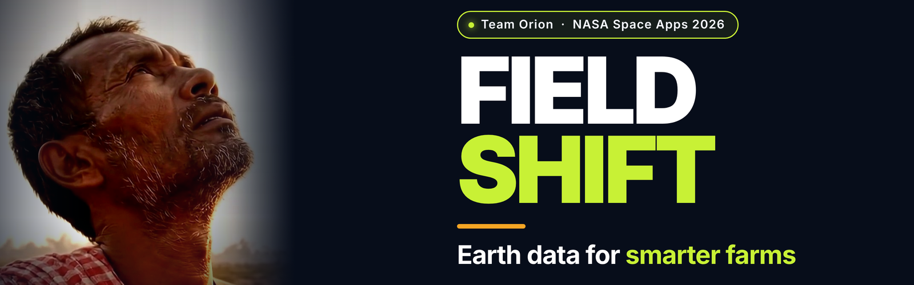
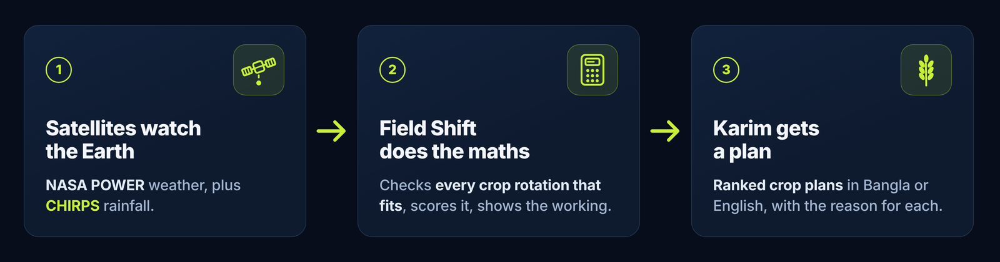
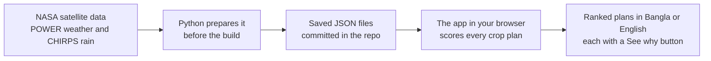
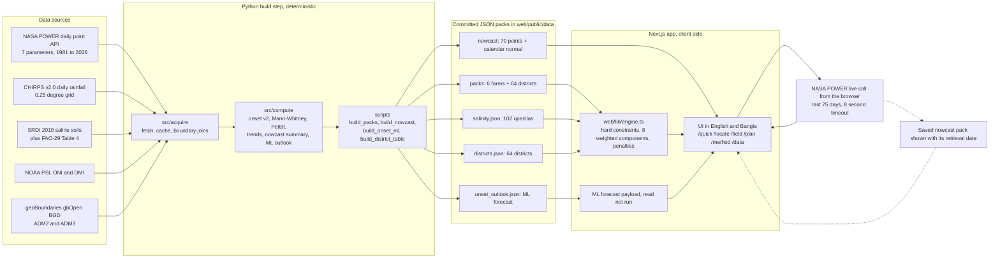
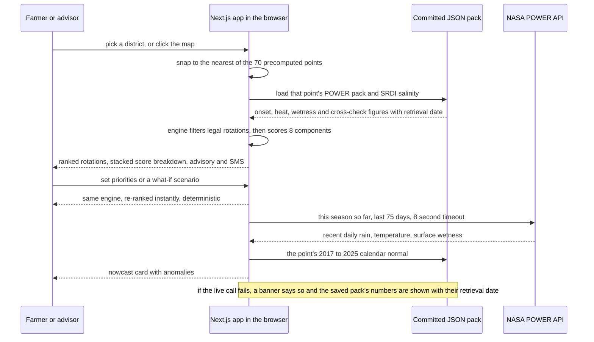

<div align="center">
<a id="top"></a>


<br>

[](https://github.com/Zul-Qarnain/field-shift/actions/workflows/ci.yml)
[](LICENSE)
[](https://www.spaceappschallenge.org/2026/challenges/field-shift-adapting-farms-with-nasa-data/)
[](https://nextjs.org/)
[](https://www.python.org/)

<br>

[](https://field-shift-tan.vercel.app)
[](https://www.spaceappschallenge.org/2026/challenges/field-shift-adapting-farms-with-nasa-data/)
[](#how-it-works)
[](#scorecard)
[](docs/AI_USE.md)

**Project video: on our NASA Space Apps project page.**

</div>

---

<a id="thirty-seconds"></a>
## ⏱️ Understand it in 30 seconds

**Field Shift helps a farmer in Bangladesh choose what to plant next, using NASA satellite data — and shows the reason for every suggestion.**



---

<a id="meet-karim"></a>
## 🌾 Meet Karim

- Karim is a farmer in our project video. He is a fictional character.
- In April he must decide what to plant for the next three seasons.
- The rains, the heat and the salt in his soil keep shifting.
- Field Shift answers on one screen, in Bangla, with the reason beside every suggestion.

> [!NOTE]
> **"By 2050, one-third of Bangladesh's agricultural GDP may be lost due to climate variability and extreme events."**
> — [World Bank, *Country Climate and Development Report for Bangladesh*](https://www.worldbank.org/en/news/feature/2022/10/31/key-highlights-country-climate-and-development-report-for-bangladesh), 2022

---

<a id="judges-checklist"></a>
## 📋 Judges' checklist

| | Rule | Field Shift |
|---|---|---|
| ✅ | Answers one published 2026 challenge | [Field Shift: Adapting Farms with NASA Data](https://www.spaceappschallenge.org/2026/challenges/field-shift-adapting-farms-with-nasa-data/) |
| ✅ | Public repository | This repository — public on GitHub |
| ✅ | Uses NASA open data | NASA POWER and NASA GIBS → [NASA data used](#nasa-data-used) |
| ✅ | Open source | [Apache-2.0](LICENSE) |
| ✅ | Team identified, with roles | Six members → [Team Orion](#team) |

---

<a id="see-it-working"></a>
## 👀 See it working

<table>
  <tr><td width="50%"></td><td width="50%"></td></tr>
  <tr><td><b>Home, in English.</b> Six demo farms across six divisions, and every district.</td><td><b>Home, in Bangla.</b> The same page, the same numbers, Bengali digits throughout.</td></tr>
</table>

<table>
  <tr><td width="50%"></td><td width="50%"></td></tr>
  <tr><td><b>Quick answer.</b> Three choices in, three ranked plans out — on one screen.</td><td><b>See why.</b> The arithmetic behind the score, in Bangla, with its data source.</td></tr>
</table>

<table>
  <tr><td width="50%"></td><td width="50%"></td></tr>
  <tr><td><b>Choose a district.</b> Any of the 64 answers with that district's own data.</td><td><b>Or click the map.</b> It names the point it used and how far away it is.</td></tr>
</table>

<table>
  <tr><td width="50%"></td><td width="50%"></td></tr>
  <tr><td><b>This season so far.</b> The last 30 or 60 days of NASA data, fetched live.</td><td><b>If the live call fails,</b> a banner says so and the saved numbers appear with their date.</td></tr>
</table>

<details>
<summary><b>Farm page (full)</b> — onset, heat, soil wetness, the CHIRPS cross-check, salinity, the forecast and the season card</summary>


</details>

---

<a id="how-it-works"></a>
## ⚙️ How it works



- **No server, no API key, no AI model runs inside the app.** The science happens in Python before the build; the browser only reads the result.
- **Every number names its dataset**, its version and the day it was downloaded.
- **Same inputs always give the same answer.** Nothing is random.

<details>
<summary><b>For engineers:</b> full architecture diagram</summary>





Longer version: [Technical Reference](docs/TECHNICAL_REFERENCE.md) · [System architecture v1.5](docs/FIELD_SHIFT_SYSTEM_ARCHITECTURE.md)

</details>

### What Field Shift does

| Page | In plain words |
|---|---|
| **Quick answer** · `/quick` | Pick a district, say what is growing now and what matters most. Three crop plans come back, best first. |
| **Location picker** · `/locate` | Click the map or choose any of the 64 districts. The app names the data point it used, and the distance. |
| **Field analysis** · `/field` | One card per farm: when the rain now starts, how often it passes 35 °C, how wet the root zone is, how salty the soil. |
| **Crop plan** · `/plan` | Move four priority sliders, or test a drier or hotter season. The ranking updates on the spot. |
| **Method & Data** · `/method`, `/data` | Every rule in plain words, and every dataset with its provider, version and download date. |

---

<a id="nasa-data-used"></a>
## 🛰️ NASA data used

| NASA dataset | What it is used for | Where it is in the repo |
|---|---|---|
| **NASA POWER** daily point API<br>1981–2026 · 70 locations | Rainfall, temperature, soil wetness and humidity — the monsoon onset, the hot-day counts, and the machine-learning inputs | [`src/acquire/power.py`](src/acquire/power.py) · [`scripts/build_packs.py`](scripts/build_packs.py) · [`web/public/data/packs/`](web/public/data/packs/) |
| **NASA POWER** nowcast series<br>2017–2026 · also fetched live in the browser | The "This season so far" card on every farm page | [`scripts/build_nowcast.py`](scripts/build_nowcast.py) · [`web/public/data/nowcast/`](web/public/data/nowcast/) · [`web/lib/nowcast.ts`](web/lib/nowcast.ts) |
| **NASA GIBS** — VIIRS NOAA-20 True Color | The satellite photo layer under the map | [`web/components/MapLive.tsx`](web/components/MapLive.tsx) |

Other open data is used alongside it — CHIRPS v2.0, SRDI soil salinity, FAO-29, NOAA ONI/DMI, geoBoundaries and OpenStreetMap — each labelled with its own tier in the app. Full licences and retrieval dates: [Technical Reference → Data sources](docs/TECHNICAL_REFERENCE.md#data-sources).

---

<a id="scorecard"></a>
## 🏆 Scorecard: how Field Shift answers the judging criteria

| Criterion | What judges look for | How Field Shift answers it | Evidence |
|---|---|---|---|
| **Impact**<br>20 | The scale and significance of the problem, and how far the solution reaches. | Bangladesh's three-season calendar, all 64 districts and six demo farms, in Bangla and English, on a problem the World Bank says may cost one-third of agricultural GDP by 2050. | [Meet Karim](#meet-karim) · [districts.json](web/public/data/districts.json) |
| **Creativity**<br>20 | Originality of the idea and of the execution. | It ends on a sentence rather than a chart: "See why" opens the arithmetic, the score bar visibly adds up to the total, and the advice comes out SMS-length in Bangla. | [Quick answer](docs/screenshots/readme/05_quick_answer_en.png) · [See why](docs/screenshots/readme/06_quick_answer_see_why_bn.png) |
| **Validity**<br>20 | Scientific soundness, technical feasibility, usability. | NASA POWER is cross-checked against independent CHIRPS rainfall, gated by a Mann-Whitney test at p < 0.05 and a Pettitt change-point test, and pinned by 260 pytest, 688 Vitest and 12 Playwright tests on a passing CI run. | [Monsoon onset science](docs/science/onset.md) · [CI workflow](.github/workflows/ci.yml) |
| **Relevance**<br>20 | Alignment to the challenge, and how deeply NASA data sits at the core. | Every challenge requirement maps to a shipped page, and NASA data is the backbone: every figure names its dataset, version and retrieval date. | [Challenge mapping below](#challenge-mapping) · [NASA data used](#nasa-data-used) |
| **Presentation**<br>20 | Clarity, structure, storytelling, and reach to a broad audience. | A Karim-centred project video, a bilingual interface, this README, and in-app Method and Data pages that state every rule in plain words. | [See it working](#see-it-working) · [web/app/method/](web/app/method) |
| **Teamwork**<br>5 | Evidence of genuine collaboration across the team. | Six members with defined roles across engineering, research, design, story and video. | [Team Orion](#team) · [Commit history](https://github.com/Zul-Qarnain/field-shift/commits/main) |
| **User experience**<br>5 | 5 = anyone can use it. 1 = it needs significant training. | Three choices on one screen give an answer, the whole interface works in Bangla with Bengali digits, and it is built for a phone first. | [Home EN](docs/screenshots/readme/01_home_en.png) · [Home BN](docs/screenshots/readme/02_home_bn.png) |
| **NASA data usage**<br>5 | 5 = NASA open data plus other agency or third-party sources, clearly shown. | Two NASA POWER series plus NASA GIBS on the map, with non-NASA sources carried alongside under a NASA / Partner / Open tier badge. | [NASA data used](#nasa-data-used) · [web/app/data/](web/app/data) |

<a id="challenge-mapping"></a>
<details>
<summary><b>Challenge → feature:</b> how Field Shift answers the requirement, line by line</summary>

| Challenge requirement | Field Shift feature | Where (page / file) |
|---|---|---|
| **NASA Earth observations** | 45 years of NASA POWER daily point data (7 parameters) for 70 locations, reduced to committed JSON packs; plus a live NASA POWER call in the browser for "This season so far" | `/field`, `/quick` · `src/acquire/power.py`, `scripts/build_packs.py`, `web/public/data/packs/` |
| **Local soil information** | Upazila soil-salinity classes from the national survey (SRDI 2010), joined to each farm by point-in-polygon and rolled up per district; expected yield loss per crop from FAO-29's own line | `/field`, `/quick` · `src/acquire/salinity.py`, `web/public/data/salinity.json` |
| **Crop characteristics** | A 12-entry Bangladesh crop pool — Aman/Aus/Boro rice, wheat, maize, potato, mustard, lentil, mungbean, sesame, jute, fallow — with duration, water demand, heat and flood tolerance, pH range, nitrogen demand/fixation, residue return, botanical family, and FAO-29 salt thresholds per crop | `web/lib/data.ts` |
| **Farmer priorities** | Four sliders — *Water saving · Soil health · Stable harvest · Heat & flood safety* — that re-weight the score instantly on device; the quick answer offers the same as one-tap presets | `/plan`, `/quick` · `web/lib/engine.ts`, `web/lib/quick.ts` |
| **Explore rotation strategies** | The engine enumerates every legal Aman → Rabi → pre-monsoon sequence from the chosen crop pool, ranks them, and re-ranks live under what-if scenarios (drier −10 %/−20 %, hotter +1 °C/+2 °C, later onset +7/+15 days) | `/plan` · `web/lib/engine.ts` |
| **Soil health** | A dedicated *Soil health balance* component (residue return, nitrogen balance, legume credit) plus *Diversity & break* (family mix, root-layer alternation), and same-family carryover penalties the farmer can read | `/plan`, "See why" · `web/lib/engine.ts` |
| **Water conservation** | *Water adequacy* and *Low irrigation reliance* components, the drier-season scenarios, and a pumping-dependence line in the advisory | `/plan` · `web/lib/engine.ts` |
| **Resilience to changing conditions** | A *Resilience* component over Aman flood exposure, dry-season heat and rain deficit; measured onset shift, days above 35 °C, mean temperature and root-zone wetness per location; a statistical gate so only a significant shift reaches a plan | `/field`, `/plan` · `src/compute/onset.py`, `web/lib/engine.ts` |
| **Accessible to farmers** | Full Bangla UI including Bengali digits, `/quick` one-screen answer, `/locate` map-click or district picker, an advisory sentence plus SMS-length text with a live 160-character counter, mobile-first layout | `/quick`, `/locate` · `web/lib/i18n.ts`, `web/lib/engine.ts` |

</details>

---

<a id="use-of-ai"></a>
## 🤖 Use of AI

| Where AI was used | Tool | Data it worked on |
|---|---|---|
| **Machine learning** — the monsoon-onset forecast | **LightGBM** gradient boosting, trained offline | CHIRPS rainfall, NASA POWER weather, NOAA ONI / DMI ocean indices |
| **Coding & documentation** | **Qoder CLI** (Qwen3.8-Flash), plus Cursor / Grok agents — all under human direction | This repository's code and documents, and the public datasets above |
| **Story clips** in the project video | **Google Veo** (the farmer Karim is fictional) · narration by **Google Gemini text-to-speech** | Text descriptions of scenes, and the team's own narration script |
| **Video support tools** | **faster-whisper** and **Demucs** | The video's own audio |

**No AI-generated data is used as a scientific input; no language model runs in the app.**

Full disclosure: [docs/AI_USE.md](docs/AI_USE.md) · prompt log: [docs/prompts_used.md](docs/prompts_used.md)

---

<a id="team"></a>
## 👥 Team Orion

| Name | Role |
|---|---|
| Mohammad Shihab Hossain | Team Leader |
| Durjo | AI/ML Engineer |
| Simon | Full-Stack Developer |
| Nafis | Video Editor |
| Bipro | Researcher |
| Prachi | UI/UX Designer |

---

<a id="run-it-yourself"></a>
## 🚀 Run it yourself

Needs [Node 22](https://nodejs.org/). Works in a fresh clone:

```bash
git clone https://github.com/Zul-Qarnain/field-shift.git
cd field-shift/web
npm ci && npm run dev        # open http://localhost:3000
```

<details>
<summary><b>Checks, tests and the Python pipeline</b></summary>

```bash
# from field-shift/web
npm run lint                # ESLint
npx tsc --noEmit            # type check
npm test                    # 688 Vitest tests
npm run build               # production build, type-checked

# from field-shift/ — the Python data pipeline (Python 3.13)
python -m venv .venv
.venv/bin/pip install -r requirements.txt
.venv/bin/python -m pytest -q     # 260 tests, no network required
```

Rebuilding the committed data packs from NASA POWER, CHIRPS and SRDI:
[Technical Reference → Rebuild the data artifacts](docs/TECHNICAL_REFERENCE.md#rebuild-the-data-artifacts)

</details>

---

<a id="roadmap"></a>
## 🗺️ Roadmap

| # | Milestone | Status |
|---|---|---|
| 1 | NASA POWER + CHIRPS data packs for all 64 districts and 6 demo farms, with onset v2, era tests, change-point tests and stated provenance | ✅ Built |
| 2 | Crop-rotation engine: hard constraints, 8 weighted components, salinity scoring from SRDI + FAO-29, what-if scenarios, Bangla/English UI, advisory + SMS text | ✅ Built |
| 3 | Machine-learning monsoon forecast: LightGBM on CHIRPS labels + NASA POWER weather + NOAA ONI/DMI, issued 25 April, shown on every farm page | ✅ Built |
| 4 | Live "This season so far" nowcast with saved-data fallback and outage banner, quick answer `/quick`, location picker `/locate`, Playwright e2e suite | ✅ Built |
| 5 | New datasets (GPM IMERG, SMAP, MODIS NDVI, SoilGrids) and farmer field tests | 🔄 In progress |

---

<a id="docs-and-credits"></a>
## 📚 Docs & credits

- Everything else lives in [docs/](docs/README.md): [architecture](docs/FIELD_SHIFT_SYSTEM_ARCHITECTURE.md) · [UI/UX design system](docs/FIELD_SHIFT_UI_UX_DESIGN_SYSTEM.md) · [monsoon onset science](docs/science/onset.md) · [machine-learning outlook](docs/science/onset_ml.md) · [Technical Reference](docs/TECHNICAL_REFERENCE.md)

**Credits:** NASA POWER (Langley Research Center) · NASA EOSDIS GIBS · CHIRPS v2.0 (Climate Hazards Center, UCSB / USGS) · SRDI, Ministry of Agriculture, Government of Bangladesh · FAO · geoBoundaries · NOAA Physical Sciences Laboratory · OpenStreetMap contributors and OpenFreeMap · background music by Kevin MacLeod, CC BY 4.0.

**License:** [Apache-2.0](LICENSE). Third-party datasets keep their own terms.

> Field Shift is a NASA Space Apps Challenge 2026 project. Not an official NASA product. NASA does not endorse this project or its recommendations. The outputs are decision-support for exploration: agronomic decisions for a specific field remain with the farmer and local extension services.

<div align="center">

**Field Shift** · Earth data for smarter farms · Team Orion · NASA Space Apps Challenge 2026, Bangladesh

</div>
